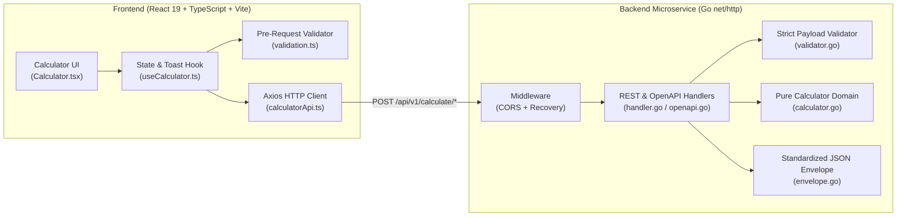

# Sezzle Full-Stack Calculator

A production-ready full-stack calculator application built with a **Go (Golang)** RESTful microservice backend and a **React + TypeScript (Vite + Axios)** frontend.

Designed with a focus on **Clean Code**, **SOLID architecture**, **Test-Driven Development (TDD)**, and **strict pre-calculation input & mathematical domain validation**.

---

## Table of Contents
1. [Architecture Overview](#architecture-overview)
2. [Features & Supported Operations](#features--supported-operations)
3. [Quick Start with Docker (Recommended)](#quick-start-with-docker-recommended)
4. [Local Development Setup](#local-development-setup)
5. [OpenAPI 3.0 & Interactive Swagger UI](#openapi-30--interactive-swagger-ui)
6. [Standardized API Contract & Examples](#standardized-api-contract--examples)
7. [Design Decisions, Clean Code & Edge-Case Rigor](#design-decisions-clean-code--edge-case-rigor)
8. [Unit Tests & Coverage Report](#unit-tests--coverage-report)
9. [AI Prompts Used](#ai-prompts-used)

---

## Architecture Overview



### Repository Structure
```text
.
├── backend/
│   ├── cmd/server/main.go               # HTTP server entrypoint with timeouts
│   ├── internal/
│   │   ├── api/
│   │   │   ├── envelope.go              # Standardized JSON response envelope
│   │   │   ├── handler.go               # REST endpoint handlers & error mapping
│   │   │   ├── handler_test.go          # Table-driven HTTP handler tests
│   │   │   ├── middleware.go            # CORS & panic recovery middleware
│   │   │   ├── openapi.go               # OpenAPI 3.0.3 spec & Swagger UI handler
│   │   │   ├── openapi_test.go          # OpenAPI & Swagger UI tests
│   │   │   └── validator.go             # Strict JSON & pointer operand validation
│   │   └── calculator/
│   │       ├── calculator.go            # Pure O(1) domain logic & math guards
│   │       └── calculator_test.go       # Exhaustive table-driven unit tests
│   ├── Dockerfile                       # Multi-stage Alpine Go build (non-root)
│   └── go.mod
├── frontend/
│   ├── src/
│   │   ├── api/
│   │   │   ├── httpClient.ts            # Configured Axios instance
│   │   │   ├── calculatorApi.ts         # Typed Axios methods per operation
│   │   │   └── calculatorApi.test.ts    # Axios unit tests
│   │   ├── components/
│   │   │   ├── Calculator.tsx           # Accessible, responsive calculator UI
│   │   │   └── Calculator.test.tsx      # Component & integration tests
│   │   ├── hooks/
│   │   │   └── useCalculator.ts         # Calculator state & 4s toast lifecycle
│   │   ├── types/
│   │   │   └── calculator.ts            # TypeScript contracts
│   │   └── utils/
│   │       ├── validation.ts            # Client-side pre-request validators
│   │       └── validation.test.ts       # Validator unit tests
│   ├── nginx.conf                       # SPA routing + /api reverse proxy
│   ├── Dockerfile                       # Multi-stage Node 22 + Nginx build
│   └── package.json
├── docker-compose.yml                   # Full-stack single-command orchestration
├── PROMPTS.md                           # AI prompts used during development
└── README.md
```

---

## Features & Supported Operations

| Operation | Type | Endpoint | Mathematical Rule & Preconditions |
| :--- | :--- | :--- | :--- |
| **Addition** | Binary (`a`, `b`) | `POST /api/v1/calculate/add` | $a + b$, rejects IEEE 754 `float64` overflow |
| **Subtraction** | Binary (`a`, `b`) | `POST /api/v1/calculate/subtract` | $a - b$, rejects IEEE 754 `float64` overflow |
| **Multiplication** | Binary (`a`, `b`) | `POST /api/v1/calculate/multiply` | $a \times b$, normalizes $-0.0 \to 0$, rejects overflow |
| **Division** | Binary (`a`, `b`) | `POST /api/v1/calculate/divide` | $a \div b$, **fails fast before division if $b = 0$** |
| **Exponentiation** | Binary (`a`, `b`) | `POST /api/v1/calculate/power` | $a^b$, **rejects $0^{\text{negative}}$ and $a < 0$ with fractional $b$** |
| **Square Root** | Unary (`a`) | `POST /api/v1/calculate/sqrt` | $\sqrt{a}$, **rejects $a < 0$ and any second operand $b$** |
| **Percentage** | Binary (`a`, `b`) | `POST /api/v1/calculate/percentage` | $(a \times b) / 100$, prevents spurious intermediate overflow |

---

## Quick Start with Docker (Recommended)

Run both the Go backend microservice and the React/Nginx frontend together with a single command:

```bash
docker compose up --build
```

- **Frontend UI**: [http://localhost:3000](http://localhost:3000)
- **Backend API Base**: [http://localhost:8080/api/v1](http://localhost:8080/api/v1)
- **Interactive OpenAPI Docs (Swagger UI)**: [http://localhost:8080/api/v1/docs](http://localhost:8080/api/v1/docs) (also accessible via [http://localhost:3000/api/v1/docs](http://localhost:3000/api/v1/docs))

To stop the containers:
```bash
docker compose down
```

---

## Local Development Setup

### Prerequisites
- **Go**: `>= 1.22`
- **Node.js**: `>= 20` and `npm`

### 1. Run the Backend Microservice
```bash
cd backend
go run ./cmd/server
```
The server listens on `http://localhost:8080` by default (configurable via the `PORT` environment variable).

### 2. Run the Frontend Application
In a separate terminal:
```bash
cd frontend
npm install
npm run dev
```
Open [http://localhost:5173](http://localhost:5173). Vite automatically proxies `/api` requests to `http://localhost:8080`.

---

## OpenAPI 3.0 & Interactive Swagger UI

The backend exposes a dedicated OpenAPI 3.0.3 specification and an interactive Swagger UI route:
- **Interactive Swagger UI**: `GET /api/v1/docs`
- **Raw OpenAPI 3.0.3 JSON Spec**: `GET /api/v1/openapi.json`

---

## Standardized API Contract & Examples

Every response from the API follows a strict, standardized JSON envelope:

```json
{
  "erro": false,
  "message": "Operation completed successfully",
  "data": {
    "operation": "add",
    "a": 12.5,
    "b": 7.5,
    "result": 20
  },
  "httpcode": 200,
  "timestamp": "2026-10-26T21:00:00Z"
}
```
On any client or domain error (`400`, `405`, `413`, `415`, `422`, `500`), `"erro"` is `true` and `"data"` is `null`:
```json
{
  "erro": true,
  "message": "division by zero is not allowed",
  "data": null,
  "httpcode": 422,
  "timestamp": "2026-10-26T21:00:00Z"
}
```

### `curl` Examples

#### 1. Addition (`POST /api/v1/calculate/add`)
```bash
curl -X POST http://localhost:8080/api/v1/calculate/add \
  -H "Content-Type: application/json" \
  -d '{"a": 15.5, "b": 4.5}'
```

#### 2. Subtraction (`POST /api/v1/calculate/subtract`)
```bash
curl -X POST http://localhost:8080/api/v1/calculate/subtract \
  -H "Content-Type: application/json" \
  -d '{"a": 50, "b": 18}'
```

#### 3. Multiplication (`POST /api/v1/calculate/multiply`)
```bash
curl -X POST http://localhost:8080/api/v1/calculate/multiply \
  -H "Content-Type: application/json" \
  -d '{"a": -7.5, "b": 4}'
```

#### 4. Division (`POST /api/v1/calculate/divide`)
```bash
curl -X POST http://localhost:8080/api/v1/calculate/divide \
  -H "Content-Type: application/json" \
  -d '{"a": 45, "b": 6}'
```

#### 5. Division by Zero — Error Example (`422 Unprocessable Entity`)
```bash
curl -X POST http://localhost:8080/api/v1/calculate/divide \
  -H "Content-Type: application/json" \
  -d '{"a": 10, "b": 0}'
```

#### 6. Exponentiation (`POST /api/v1/calculate/power`)
```bash
curl -X POST http://localhost:8080/api/v1/calculate/power \
  -H "Content-Type: application/json" \
  -d '{"a": 2, "b": 10}'
```

#### 7. Square Root — Unary Operation (`POST /api/v1/calculate/sqrt`)
```bash
curl -X POST http://localhost:8080/api/v1/calculate/sqrt \
  -H "Content-Type: application/json" \
  -d '{"a": 81}'
```

#### 8. Percentage (`POST /api/v1/calculate/percentage`)
```bash
curl -X POST http://localhost:8080/api/v1/calculate/percentage \
  -H "Content-Type: application/json" \
  -d '{"a": 20, "b": 150}'
```

---

## Design Decisions, Clean Code & Edge-Case Rigor

### 1. Fail-Fast Pre-Calculation Validation (Client & Server)
- **Never compute on invalid data**: The frontend validates raw strings, number finiteness, and operation domain rules *before* calling Axios. The backend independently validates HTTP headers, body size (`MaxRequestBodyBytes = 4096`), JSON structure, operand presence, and mathematical preconditions *before* executing any arithmetic operation.
- **Distinguishing omitted fields from `0` (`*float64` pointers)**: In Go, standard `float64` struct fields default to `0.0` when omitted from JSON, which would silently turn `{}` into `{"a": 0, "b": 0}`. Using `*float64` pointers in `CalculationRequest` guarantees that missing or `null` operands are immediately rejected with `400 Bad Request`.
- **Strict Unary vs. Binary Enforcement**: Binary endpoints require both `a` and `b`; the unary `sqrt` endpoint requires `a` and explicitly rejects requests that supply a second operand `b`.

### 2. IEEE 754 Floating-Point Boundary & Degenerate Input Handling
- **Overflow Protection**: Operations on extreme values (such as `math.MaxFloat64 + math.MaxFloat64`, `math.MaxFloat64 * 2`, `math.MaxFloat64 / 0.5`, or `10^1000`) produce `±Inf` in IEEE 754. Since RFC 8259 JSON does not support `Infinity` or `NaN`, `finalizeResult` traps non-finite results and returns `422 Unprocessable Entity` (`ErrOverflow`).
- **Intermediate Overflow Prevention in Percentage**: Computing `(a * b) / 100` directly would overflow when calculating `50%` of `math.MaxFloat64` (`50 * MaxFloat64 -> +Inf`), even though the true result (`0.5 * MaxFloat64`) is finite. `Service.Percentage` detects intermediate overflow and falls back to `(percent / 100.0) * baseValue`.
- **Negative Zero (`-0.0`) Normalization**: Expressions like `-999 * 0`, `0 / -5`, or `√(-0.0)` produce `-0.0` in IEEE 754. Both layers normalize `-0.0` to positive `0` for consistent JSON output and display.
- **Time & Space Complexity**: Every domain operation and validator executes in constant $\mathcal{O}(1)$ time and $\mathcal{O}(1)$ auxiliary space.

### 3. Clean Code & SOLID Principles
- **Single Responsibility Principle (SRP)**: Domain arithmetic (`internal/calculator`), payload validation (`internal/api/validator.go`), response formatting (`internal/api/envelope.go`), and HTTP routing (`internal/api/handler.go`) are isolated in dedicated modules.
- **Open/Closed Principle (OCP)**: Shared higher-order handlers (`handleBinaryOperation`, `handleUnaryOperation`) and the frontend `BINARY_OPERATION_EXECUTORS` dispatch map allow adding operations without modifying existing control flow.
- **Dependency Inversion Principle (DIP)**: `api.Handler` depends on the `calculator.Calculator` interface rather than concrete implementation details.
- **Toast Notification UX**: Validation and API error messages appear in a non-intrusive floating notification slot above the calculator that automatically fades out after 4 seconds (`NOTIFICATION_DURATION_MS = 4000`).

---

## Unit Tests & Coverage Report

### Run Backend Tests & Coverage
```bash
cd backend
go vet ./...
go test -v -race -coverprofile=coverage.out ./internal/...
go tool cover -func=coverage.out
```

| Backend Package | Statement Coverage |
| :--- | :--- |
| `internal/calculator` | **100.0%** |
| `internal/api` | **94.3%** |
| **Total Backend (`internal/...`)** | **95.8%** |

### Run Frontend Tests, Coverage & Linter
```bash
cd frontend
npm run test -- --run --coverage
npm run lint
npm run build
```

| Frontend Module | Statement Coverage | Function Coverage |
| :--- | :--- | :--- |
| `src/components/Calculator.tsx` | **100.0%** | **100.0%** |
| `src/utils/validation.ts` | **98.41%** | **100.0%** |
| `src/hooks/useCalculator.ts` | **89.39%** | **77.77%** |
| `src/api/calculatorApi.ts` | **87.50%** | **100.0%** |
| **Total Frontend** | **92.77%** | **93.75%** |

---

## AI Prompts Used

All prompts used during architecture planning, TDD implementation, UX refinement, and documentation are recorded in [PROMPTS.md](./PROMPTS.md).
